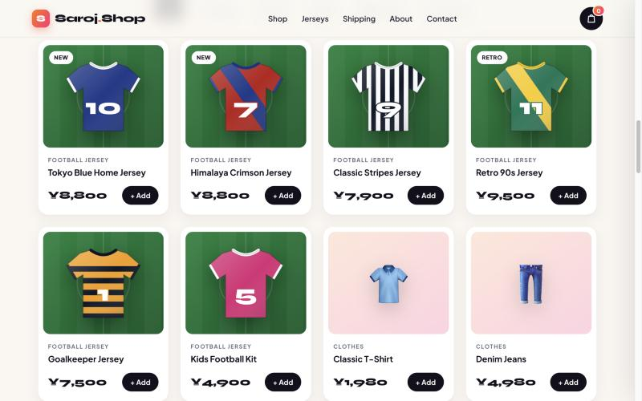
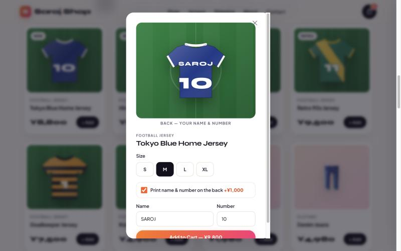
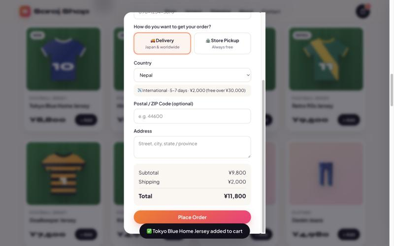
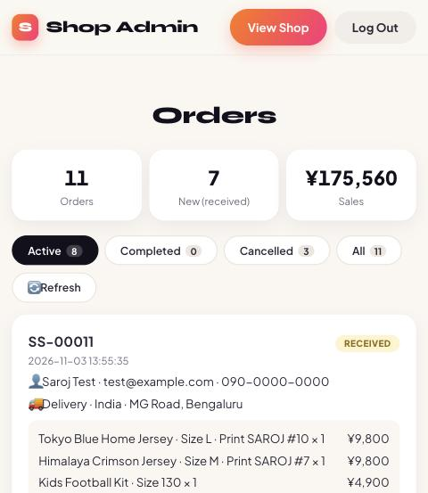
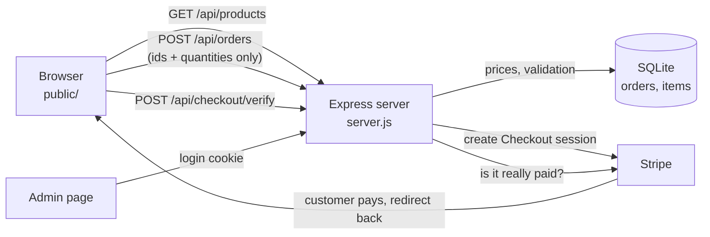

# 🛍️ Saroj Shop

**A full-stack online shop: football jerseys you can personalize, worldwide shipping, card payments and an admin dashboard.**

🌐 **Live demo:** https://saroj-shop.onrender.com
*(free hosting, so the first visit can take ~50 seconds to wake up)*

💳 Payments run in **Stripe test mode**. Try card `4242 4242 4242 4242`, any future date, any CVC. No real money is charged.


---

## ✨ Features

**Shopping**
- Product catalog with search and category filters (clothes, shoes, electronics, accessories, football jerseys)
- Football jerseys drawn with **SVG code** (no image files), on a football-pitch background
- **Jersey personalization:** choose a size (S–XL, kids 120–150) and print a name + number on the back, with a **live preview**
- Cart saved in `localStorage`, so it survives a page refresh

**Checkout**
- **Delivery** to Japan + 26 countries with zone-based shipping (Japan / Asia / rest of the world) and free-shipping thresholds
- **Free store pickup** with store, date (tomorrow to +14 days) and time-slot selection
- **Card payment with Stripe Checkout.** The server confirms each payment directly with Stripe

**Admin dashboard**
- Login with session cookies
- Order list with **Active / Completed / Cancelled / All** tabs, status updates, paid badges and sales totals

**Design**
- Custom design system: Syne + Plus Jakarta Sans, gradient accents, glass cards, animated hero, scrolling marquee
- Scroll-reveal animations, responsive down to 375px phones, respects `prefers-reduced-motion`

| Products | Jersey options |
|---|---|
|  |  |

| Worldwide checkout | Admin dashboard | Mobile |
|---|---|---|
|  |  |  |

---

## 🧰 Tech stack

| Layer | Technology |
|---|---|
| Frontend | HTML, CSS (custom properties, grid, flexbox, animations), vanilla JavaScript (ES6+, `fetch`, event delegation) |
| Backend | Node.js 22+, Express 5, REST API |
| Database | SQLite (built-in `node:sqlite`), transactions, schema migrations |
| Payments | Stripe Checkout (test mode) |
| Hosting | Render (auto-deploy from GitHub) |

## 🏗️ How it works



## 🔒 Security decisions

- **The server never trusts prices from the browser.** The browser sends only product IDs, quantities and options; the server recalculates every price and shipping fee.
- **Every input is validated again on the server:** sizes, print names (A–Z only), numbers (0–99), countries, postal codes, pickup dates.
- **Payments are verified server-side** with the Stripe API, so a fake "success" URL can't mark an order as paid.
- **Only Stripe test keys are accepted** (`sk_test_…`), so live money can't be charged by mistake.
- **Admin login:** scrypt password hashing with `timingSafeEqual`, random session tokens, `HttpOnly` + `SameSite=Strict` + `Secure` cookies, and a lockout after 5 wrong attempts.
- **XSS protection:** customer-entered text is escaped before it is shown on the admin page.
- **Secrets live in environment variables** (`.env` locally, Render dashboard online) and are never committed.

## 📡 API

| Method | Endpoint | Purpose |
|---|---|---|
| `GET` | `/api/products` | Product list |
| `GET` | `/api/config` | Is card payment on? |
| `POST` | `/api/orders` | Create an order (returns a Stripe Checkout URL when payments are on) |
| `POST` | `/api/checkout/verify` | Confirm a payment with Stripe |
| `POST` | `/api/admin/login` · `/logout` | Admin session |
| `GET` | `/api/orders` | All orders *(admin)* |
| `PATCH` | `/api/orders/:id/status` | Change order status *(admin)* |

## 📁 Project structure

```
saroj-shop/
├── server.js            # Express app: API, database, admin login, Stripe
├── products.js          # Product catalog, jersey sizes, print price
├── public/
│   ├── index.html       # Shop page
│   ├── style.css        # Design system + all page styles
│   ├── script.js        # Shop logic: catalog, cart, jersey options, checkout
│   ├── shipping.js      # Shipping rules, shared by browser AND server
│   ├── admin.html/.js   # Admin dashboard
│   └── login.html/.js   # Admin login
├── render.yaml          # Render deploy blueprint
└── .env.example         # Settings template (copy to .env)
```

## ▶️ Run it locally

Requires **Node.js 22.13+**.

```bash
npm install
cp .env.example .env   # then set your own ADMIN_PASSWORD (and optionally a Stripe test key)
npm start
```

- Shop: http://localhost:3000
- Admin: http://localhost:3000/admin.html

## 🚀 Deploy

1. Push the repository to GitHub.
2. On [Render](https://render.com): **New → Blueprint** → select the repository (it reads `render.yaml`).
3. Set `ADMIN_PASSWORD` and (optional) `STRIPE_SECRET_KEY` in the service's **Environment** settings.

> ⚠️ On Render's free plan the server sleeps after 15 minutes without visitors, and the SQLite file is reset on restart. A production shop would use a hosted database.

## 🗺️ What's next

- Hosted database (PostgreSQL) so orders persist across restarts
- Product detail pages
- Order confirmation emails
- Legal pages (特定商取引法に基づく表記, privacy policy)

## 👤 Author

**Saroj Gurung** · Web developer based in Tokyo, Japan
GitHub: [@sarojgrg1090-dev](https://github.com/sarojgrg1090-dev)

*Built with AI pair-programming (Claude Code) as a hands-on full-stack learning project.*
